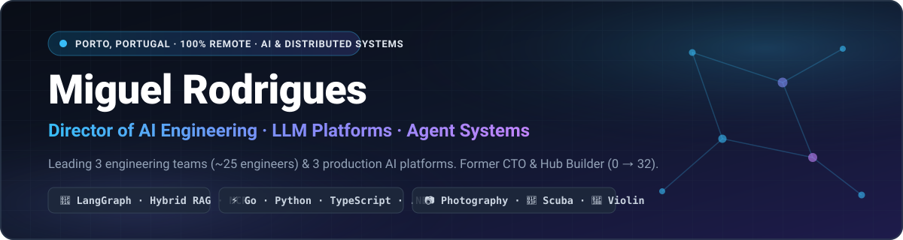

  

   
   

  

    
    
    
    
    
    
  

---

## ⚡ Executive Summary

I'm an engineering leader and systems architect based in **Porto, Portugal 🇵🇹**, currently serving as **Director of AI Engineering at [Foundever](https://foundever.com/)**, where I lead **3 engineering teams (~25 engineers)** owning **3 production AI platforms** used daily across legal, finance, operations, and global contact centers.

Over the past decade, I've scaled engineering organizations from **0 → 32 engineers**, served as **CTO** in luxury fintech, and built mission-critical distributed systems, big data pipelines, and multi-agent LLM platforms.

- 🔭 **Current Focus**: Enterprise **Multi-Agent Orchestration** (`LangGraph`, `MCP`, `Agent-to-Agent`), **Permission-Aware Hybrid RAG** (`Elasticsearch`, `Azure Document Intelligence`), **Voice AI** (`Deepgram`, `Azure Speech`), and **AI Governance Gateways** on `Backstage.io`.
- 🚀 **Creator of [Caravela AI](https://www.caravela.io/)**: Production AI assistant for engineering teams — automating ticket triage, repository navigation, and operational intelligence.
- 🏗️ **Track Record**: Former **CTO at Twig.ae**, **Tech Lead & Employee #1 in Portugal at [Axonius](https://www.axonius.com/)** (grew hub `0 → 32`), and **Senior R&D Engineer at Farfetch** (operated a **Diem** blockchain validator node alongside Spotify, Uber & Shopify).

---

## 🏛️ Career & Architecture Highlights

| Role & Organization | Period | Key Engineering & Leadership Impact |
| :--- | :---: | :--- |
| **Director of AI Engineering** **[Foundever](https://foundever.com/)** · *Porto (Remote)* | `2025 – Present` | • Lead **3 teams (~25 engineers)** owning **3 production AI platforms**; cut time-to-production by **~40%**. • Shipped **EverGPT** (`Claude Opus`, `GPT-5.2`, `LangGraph`, `MCP`, `A2A`) & **EverConnect** (permission-aware Hybrid RAG on `Elasticsearch` + `Azure Document Intelligence`). • Deployed **AI Agent Foundry** (`Deepgram`, `Azure Speech`), reducing peak call queue overflow by **~35%**. • Architected enterprise AI governance on **Backstage.io** and an internal **AI Agent Gateway**. |
| **Chief Technology Officer (CTO)** **Twig.ae** · *Dubai, UAE (Remote)* | `2024 – 2025` | • Directed engineering, architecture, and hiring for a GCC luxury retail payments fintech. • Designed a **Gemini + LangGraph** eligibility engine at **~95% accuracy**, processing thousands of daily transactions. • Decomposed monolith into **Fastify** microservices on **AWS / PostgreSQL** with **AWS CDK** (**~60%** lower latency & deploy time) and launched a **React Native** app (**2x** conversion). |
| **Tech Lead (Employee #1 PT)** **[Axonius](https://www.axonius.com/)** · *Remote, EU* | `2022 – 2024` | • Opened the Portugal engineering hub as **Employee #1** and scaled the organization from **0 to 32 engineers**. • Delivered **140+ cybersecurity & asset integration adapters** for enterprise customers. • Engineered **Hadoop** big data asset pipelines surfacing **600k+ risk findings** per batch run and real-time **Elasticsearch** relationship graphs. |
| **Senior R&D Engineer / Software Engineer** **Farfetch** · *Porto, Portugal* | `2020 – 2021` | • First R&D hire; operated Farfetch's **Diem** blockchain validator node, built IPFS NFT authenticity certificates, and shipped a 3D luxury inspection mobile POC. • Architected a **Kafka** Communication Hub and a globalization microservice across **50+ services**, leading **Helm + Argo CD** adoption. |
| **Software Engineer** **Critical Manufacturing** & **E-Goi** | `2015 – 2019` | • **Critical Manufacturing**: Core MES engineer for **BMW, Renault & IKEA**; led Docker Swarm → **Kubernetes** migration (**-30%** infra spend, **~65%** faster deploys). • **E-Goi**: Scaled multi-channel marketing platform to **70k customers** and **~3M messages/day** peak. |

---

## 🛠️ Technology Arsenal

### 🤖 AI, LLMs & Agentic Systems

  
  
  
  
  
  
  
  
  
  

### 📊 Big Data, Cloud & Platform Engineering

  
  
  
  
  
  
  
  
  

### 💻 Core Languages & Frameworks

  

---

## 🚀 Featured Projects & Writing

- 🧭 **[Caravela AI](https://www.caravela.io/)** — Production AI engineering assistant for ticket triage, codebase graph navigation, and operational intelligence (`Golang`, `Claude Opus`, `GPT-5.2`, `Hybrid RAG`, `LangGraph`, `MCP`, `AWS`).
- 🌐 **[miguelrodrigues.org](https://miguelrodrigues.org/)** — Personal hub, interactive engineering portfolio, and technical blog.
- 📦 **[Blogger IPFS](https://github.com/JoseRodrigues443/blogger-ipfs)** — Decentralized blog publishing and permanent storage built on IPFS.

<!-- BLOG-POST-LIST:START -->
### ✍️ Recent Articles on [miguelrodrigues.org](https://miguelrodrigues.org/)
- 📄 **[Automating Reports with Gemini: Drive to Gmail Integration](https://miguelrodrigues.org/)** — *AI & Automation*
- 🤖 **[Building a Context-Aware Telegram Meme Bot with Gemini Nano](https://miguelrodrigues.org/)** — *AI & Bots*
- 🧠 **[Integrating Notion Pages with Google NotebookLM](https://miguelrodrigues.org/)** — *Productivity & RAG*
<!-- BLOG-POST-LIST:END -->

---

## 🌊 Beyond the Terminal — Hobbies & Passions

When I'm not architecting multi-agent platforms or leading engineering teams, you'll find me exploring the world above and below the surface:

| Passion | What I Do |
| :--- | :--- |
| 📷 **Photography** | Capturing travel landscapes, street stories, architecture, and nature in RAW — blending optical composition with local AI vision workflows for cataloging and curation. |
| 🤿 **Scuba Diving** | Certified **SSI Open Water Diver** (`ISO 24801-2`). Exploring Atlantic kelp forests, rocky reefs, and marine life across **Portugal** and **Galicia** (*Rías Baixas* & *Cíes Islands*). |
| 🎻 **Violin & Music** | Playing the **violin** — a lifelong passion for string acoustics, classical repertoire, and deep-focus music. |
| 🎾 **Padel, Strength & Trails** | Weekly **Padel** matches, strength & kettlebell conditioning, and Sunday morning mountain trail hikes in **Serra de Valongo** (Porto). |

---

## 📈 GitHub Activity & Streak

  

---

  Built from <b>Porto, Portugal 🇵🇹</b> · <a href="https://miguelrodrigues.org/">miguelrodrigues.org</a> · Reach out at <a href="mailto:josemiguel443@gmail.com">josemiguel443@gmail.com</a>

